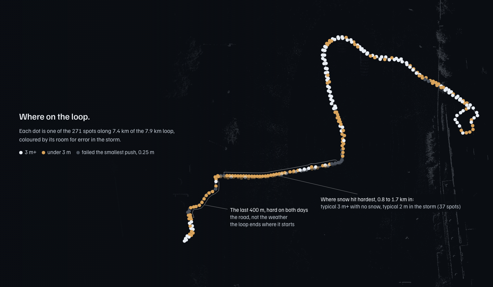

# Snowbound

Does snow shrink a self-driving car's room for error? A test on a real Toronto snowstorm drive, with real lidar, at 271 spots.

## The result

Snow shrinks a self-driving car's room for error. Room for error is the biggest push off its map a car's position guess can take and still find its way back. At 271 spots on a 20 m grid along 7.4 km of a 7.9 km north Toronto loop (a spot was kept only where both drives had a scan, so they sit 20 to 40 m apart), on both days, I pushed the guess off on purpose (0.25 m up to 3 m, in 8 directions, with a 5 degree turn added) and let the scan matcher slide the scan back onto a map from two months earlier.

- Typical spot in the snowstorm (26 Jan 2021): 2.5 m. Typical spot with no snow falling (19 Jan 2021): 3 m+ (3 m was the biggest push tested, so 3 m+ means it never failed).
- Snow cut the room for error at 111 of 271 spots. It hit hardest in segments 2 and 3 of the loop: 34 of their 41 spots were cut (typical storm 1.625 m and 2 m there, no snow 3 m+). It made no difference at 142 spots and widened the room at 18.
- The last 400 m is hard on both days: the road, not the weather. Every value is good to about half a metre.




The site, with the real scans, the push you can try yourself and the twelve-second clip: https://wilsawn.github.io/snowbound/ (source in `docs/`). Full write-up: `notes/results-zlock.md` (the height-locked run the numbers come from), `notes/results-why-spots.md` (why some spots and not others: the "wide open road" idea does not hold).

Data: the [Boreas dataset](https://www.boreas.utias.utoronto.ca/) (University of Toronto, CC BY 4.0, [paper](https://arxiv.org/abs/2203.10168)). The study this builds on: Burnett et al., [arXiv 2203.10174](https://arxiv.org/abs/2203.10174). The drives are not in this repo; docs/data holds two sampled scans and docs/media the frames and clip the site uses, all from Boreas (CC BY 4.0).

## Run it
```
make setup    # Python 3.12 env via uv
make doctor   # checks tools and data
make test     # runs the tests
```
Data lives in `~/snowbound-data` (or set `SNOWBOUND_DATA`). Download the drives with `scripts/fetch_boreas.py` and `scripts/fetch_route.py`. The whole-route test is `scripts/sweep_route_zlock.py` (results in `results/route_*_zlock.csv`, compared by `scripts/compare_zlock.py`); the site's data file `docs/data/route.json` is built by `scripts/build_site.py`.

## How it was measured
The map is the same loop driven in clear weather on 26 Nov 2020. The matcher is point-to-plane ICP (scipy) with the car's height locked to the road; it may only slide and turn. A push is recovered if the scan lands within 30 cm and 2 degrees of the truth, and a size passes when 7 of 8 directions recover. Room for error is the biggest push that passed before the first size that failed. An earlier run let the matcher sink storm scans about 2.5 m so the snow in the air landed on the road, which counted failures that were not failures; it said 147 spots. With the height locked the honest count is 111.

Limits: one drive per kind of weather; 202 no-snow spots and 120 storm spots hit the 3 m cap, so the real gap is at least what the numbers show; 12 spots fail the smallest push on both days (the method, not the snow); neighbouring spots share road, so the counts are not independent trials; a wider search window makes the numbers bigger.

## Status
- [x] Step 1: setup, loader, data tests
- [x] Step 2: first numbers on a 60 s stretch (`notes/results-60s-storm.md`)
- [x] Step 3: stress test over the whole loop, both days, height locked (`notes/results-zlock.md`)
- [x] Step 6: results page (`docs/`) and the clip
- [ ] Reproduce the paper's 2.3 cm with open tools (KISS-ICP, Open3D, evo)
- [ ] One fix: a snowflake filter (DROR) on the raw scans
- [ ] One core piece in C++

## Who built what
- Written by Delo: tests/test_loader.py
- Written with Claude (AI): scripts/fetch_boreas.py, scripts/doctor.py, src/snowbound/loader.py
- Written with Claude (AI): scripts/fetch_control.py, scripts/score_60s.py, scripts/sweep_basin.py
- Written with Claude (AI), Nov 21 and 22: scripts/compare_basins.py, plot_basin_map.py, plot_street_map.py, render_chase.py, render_realstreet.py, car_mesh.py, fetch_control_camera.py, fetch_route.py, sweep_route.py, sweep_timer.sh, build_site.py
- Written with Claude (AI), Nov 23 to 26: scripts/sweep_route_zlock.py, compare_zlock.py, spot_cam_hd.py, why_spots.py, view_scan.py, the critic checks in scripts/critic/ (check_truth.py, poses_cov.py, zlock_sweep.py), and the website in docs/
- Used as-is: KISS-ICP, Open3D, evo, Rerun

## License
MIT, see `LICENSE`. The Boreas data is CC BY 4.0 and belongs to the University of Toronto. Not affiliated with the University of Toronto or any car company.
