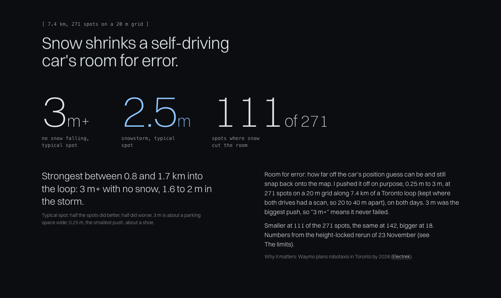

# Snowbound

Does snow shrink a self-driving car's room for error? A test on a real Toronto snowstorm drive, with real lidar, at 271 spots.

## The result

Snow shrinks a self-driving car's room for error. Room for error is the biggest push off its map a car's position guess can take and still find its way back. At 271 spots on a 20 m grid along 7.4 km of a 7.9 km north Toronto loop (a spot was kept only where both drives had a scan, so they sit mostly 20 to 40 m apart), on both days, I pushed the guess off on purpose (0.25 m up to 3 m, in 8 directions, with a 5 degree turn added) and let the scan matcher slide the scan back onto a map from two months earlier.

- Typical spot in the snowstorm (26 Jan 2021): 2.5 m. Typical spot with no snow falling (19 Jan 2021): 3 m+ (3 m was the biggest push tested, so 3 m+ means it never failed).
- Snow cut the room for error at 111 of 271 spots. It hit hardest in segments 2 and 3 of the loop: 34 of their 41 spots were cut (typical storm 1.625 m and 2 m there, no snow 3 m+). It made no difference at 142 spots and widened the room at 18.
- The last 400 m is hard on both days: the road, not the weather. Every value is good to about half a metre.




The site, with the real scans, the push you can try yourself and the twelve-second clip: https://wilsawn.github.io/snowbound/ (source in `docs/`). Full write-up: `notes/results-zlock.md` (the height-locked run the numbers come from), `notes/results-why-spots.md` (why some spots and not others: the "wide open road" idea does not hold).

Data: the [Boreas dataset](https://www.boreas.utias.utoronto.ca/) (University of Toronto, CC BY 4.0, [paper](https://arxiv.org/abs/2203.10168)). The study this builds on: Burnett et al., [arXiv 2203.10174](https://arxiv.org/abs/2203.10174). The drives are not in this repo; docs/data holds two sampled scans and docs/media the frames and clip the site uses, all from Boreas (CC BY 4.0).

## Run it
```
make setup    # Python 3.12 env via uv
make doctor   # checks tools and data
make test     # runs the tests
```
Data lives in `~/snowbound-data` (or set `SNOWBOUND_DATA`). Download the drives with `scripts/fetch_boreas.py` and `scripts/fetch_route.py` (about 25 GB for the three drives used here). The whole-route test is `scripts/sweep_route_zlock.py` (results in `results/route_*_zlock.csv`, compared by `scripts/compare_zlock.py`); the site's data file `docs/data/route.json` is built by `scripts/build_site.py`.

## How it was measured
The map is the same loop driven in clear weather on 26 Nov 2020. The matcher is point-to-plane ICP (scipy) with the car's height locked to the road; it may only slide and turn. A push is recovered if the scan lands within 30 cm and 2 degrees of the truth, and a size passes when 7 of 8 directions recover. Room for error is the biggest push that passed before the first size that failed. An earlier run let the matcher sink storm scans about 2.5 m so the snow in the air landed on the road, which counted failures that were not failures; it said 147 spots. With the height locked the honest count is 111.

Limits: one drive per kind of weather, so this is a lead, not a law. 202 no-snow spots and 120 storm spots hit the 3 m cap, so the real gap is at least what the numbers show. 12 spots fail the smallest push on both days: the method, not the snow. The last 400 m is hard on both days: the road, not the weather. Every value is good to about half a metre. The height lock (23 Nov 2026) changed 101 storm values and 17 no-snow values; the count of spots where snow cut the room went from 147 to 111, the typical values did not move, and 18 storm spots still read 0 m, 12 of them on both days (the free-matcher numbers stay in results/ for comparison). The two days differ in more than falling snow: a week of parked cars and snowbanks, and the no-snow car drove faster. The map is thinner over most of the loop than on the first street measured; re-running that street gave the same conclusion but storm values about one step smaller. The result holds for these matcher settings; a wider search window recovers more often and makes the numbers bigger. Neighbouring spots share road, so the counts are not independent trials. On the site, the dashcam frames are untouched apart from a light grade on the opening photo, and the falling snow drawn over that photo is an effect, not data; the lidar scans are real scans with only the car's own body (within 3 m) and points beyond 60 m removed, thinned at random to 200,000 points each in the files, drawn as 150,000 on a fast computer, 80,000 on most and 40,000 on phones.

## Status
Done: the loader and data checks, the first 60 s test, the whole-loop stress test on both days with the height locked, the why-spots analysis, the site and the clip. Not done: reproducing the paper's 2.3 cm with open tools, a snowflake filter on the raw scans.

## Repo map
- `docs/`: the site (one page, its data files and media). GitHub Pages serves it from here.
- `notes/`: the write-ups; `notes/README.md` says what to read first.
- `results/`: the CSVs and figures; `results/README.md` says which file is which.
- `scripts/`: the code that made every number and image; `scripts/README.md` maps scripts to outputs. `src/snowbound/loader.py` reads the Boreas files.
- `tests/`: three checks on the data layout (they skip when the data is not on disk).

Built by Wilsawn Dideh.

## License
MIT, see `LICENSE`. The Boreas data is CC BY 4.0 and belongs to the University of Toronto. Not affiliated with the University of Toronto or any car company.
