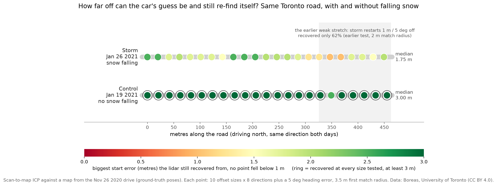

# Road or snow? The weak stretch, tested on a day without falling snow (Nov 21, 2026)
Every number was checked separately against the CSVs. Scripts: scripts/score_60s.py, scripts/sweep_basin.py, scripts/compare_basins.py, scripts/plot_basin_map.py. Raw CSVs: results/control-60s/, results/basin_storm.csv, results/basin_control.csv, results/basin_pairs.csv. Picture: results/basin_map.png.

## The question
In the storm drive, restarting the car's position guess 1 m / 5 deg off was recovered 100% of the time in seconds 0 to 40, but only 62% in seconds 40 to 60. Is that stretch of road hard, or was it the falling snow?

## The test
Same road, same direction, two days: the storm (boreas-2021-01-26-11-22, Jan 26 2021, snow falling) and a control a week earlier (boreas-2021-01-19-15-08, Jan 19 2021, snow on the ground, none falling). Both localized against the same map, built from the Nov 26 2020 drive with ground-truth poses.
- The control car drove about 1.9x faster (median 15.3 m/s vs 7.9 m/s at the test points; ranges 8 to 17 m/s vs 5 to 10 m/s), so its scans are further apart. We used every 3rd control scan (median 4.7 m apart) against every 5th storm scan (4.0 m apart). Control scan-seconds 2 to 33.7 cover the same road as storm scan-seconds 0 to 60; storm 40 s (326 m along the storm track) is within 3 m of control 25.1 s.
- Sanity gate first (true start, whole stretch). Then the 1 m / 5 deg restart test, split at the same place as the storm. Then the basin sweep: at a test point every 20 m, push the start guess off by 0.25 to 3 m in 8 directions, with a 5 deg heading error, and record the biggest size that still recovers in at least 7 of 8 directions. Same seed, same settings (3.5 m first match radius) on both days.
- "Recovered" = final error under 0.3 m and 2 deg vs ground truth.

## Sanity gate: passed
Control, true start, 103 scans over 32 s: recovered 100%, lateral RMSE 1.4 cm, longitudinal 3.4 cm (mean +3.3), height 4.8 cm (mean +4.6), heading 0.04 deg. The pipeline works on the control day about as well as on the storm day (storm: 1.1 cm lateral, 1.9 cm longitudinal).

## Restart 1 m / 5 deg off (score_60s.py, 2 m first match radius)
| Stretch (storm seconds, metres along road) | Storm recovered | Control recovered |
|---|---|---|
| 0 to 40 s, 0 to 326 m | 100% (78 of 78) | 100% (74 of 74) |
| 40 to 60 s, 326 to 462 m | 62% (24 of 39) | 96% (26 of 27) |

The control's one failure sits at 374 m along the road (final error 0.72 m, heading 1.0 deg), inside the same stretch where the storm struggles. The storm's 62% is from results/storm-60s/off_40.csv; re-run on the Mac on Nov 21 it is again 62% (24 of 39, results/control-60s/storm_off_40_mac_rerun.csv, identical line for line), so the two days were scored by the same code on the same machine.

## Basin sweep (sweep_basin.py, 3.5 m first match radius, 5 deg heading error added)
23 test points per day, 20 m apart, 22 paired by location (nearest control point within 5 m; median gap 1.8 m). The last storm point (449 m) has no control partner because the nearest control point is 5.9 m away, over the 5 m limit.

| | Storm | Control |
|---|---|---|
| Median basin radius | 1.75 m | at least 3 m (22 of 23 points recovered at every size tested) |
| Smallest basin | 1.0 m (at 347 and 367 m along the road) | 2.5 m (at 349 m) |
| Recovery at 1 m | 99.5% | 100% |
| Recovery at 2 m | 72% | 100% |
| Recovery at 3 m | 38% | 97% |
| Heading alone +/-5 deg | 100% | 100% |
| Heading alone +/-10 deg | 0% | 26% |

Paired difference, storm minus control, over the 22 pairs: median -1.25 m, mean -1.15 m. The storm margin was smaller at all 22 pairs, bigger at none (sign test p < 0.001, but the points 20 m apart share road, so treat it as rough).
- Storm 0 to 40 s stretch (16 pairs): storm median 2.0 m vs control 3 m or more, difference median -1.0 m.
- Storm 40 to 60 s stretch (6 pairs): storm median about 1.4 m (1.375) vs control 3 m or more, difference median -1.5 m.

## The answer: mostly the snow, with a small road effect in the same place
- Without falling snow, the "weak stretch" is not weak: 96% of 1 m / 5 deg restarts recovered, and 5 of the 6 paired control points there (6 of the 7 control points in that stretch) recovered from every offset up to 3 m.
- With falling snow, the margin is smaller along the whole road, not only the last 20 s: every one of the 22 paired points lost 0.5 to 2 m of margin. The last stretch is where the storm margin gets smallest (1.0 m at two points).
- The road does contribute a little: the one control point that did not survive 3 m (349 m) and the one control restart that failed (374 m) both sit in the 326 to 462 m stretch, right where the storm is worst (1.0 m at 347 and 367 m). So that part of the road is a bit harder on any day, and snow turns "a bit harder" into "fails 1 m restarts".
- Plain version for a post: on this road, falling snow cut the distance the lidar can re-find the car from, from more than 3 m to about 1.75 m, and down to 1 m at the worst spot.

## Honest limits
- One stretch of one road (about 460 m, straight, heading north), one drive per weather. Not "snow does X", only "this snowy day vs that day on this road".
- The two days differ in more than falling snow: a week of snowbank and parked car changes, and the control car drove about 1.9x as fast (its scans are more motion-smeared; deskew uses ground truth, so this is mostly handled, but not proven).
- The map is built from ground-truth poses of a drive 2 months before the storm (Burnett et al. built theirs from lidar only). Road changes over those 2 months affect both days the same way, which is the point of the control.
- Results hold for these ICP settings: scipy point-to-plane, Huber weights, 3.5 m first match radius in the sweep, 2 m in the restart test. The window matters: with the 3.5 m radius, 1 m restarts recover 99.5% of the time even in the storm, while the 2 m radius gave 62% on the weak stretch. Always say which.
- The control basins are capped: 22 of 23 points recovered at every size up to 3 m, so the real control margin is "at least 3 m", not a number. The storm minus control difference is therefore "at least" the values above.
- The sign test treats the 22 pairs as independent. They are 20 m apart on the same road, so they are not.
- Points where the control's nearest storm point is up to 5.9 m away were still drawn on the map; pairs used for the difference were kept to 5 m.
